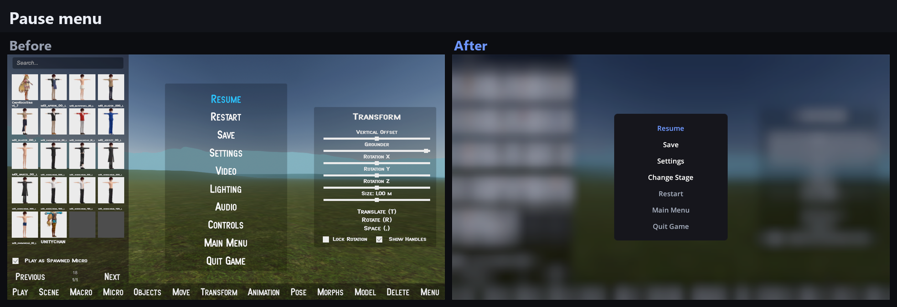
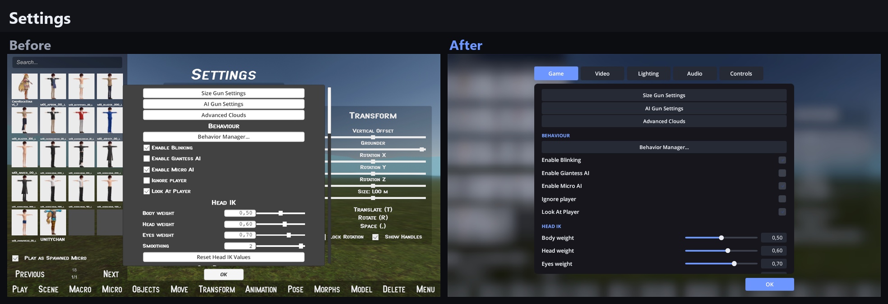
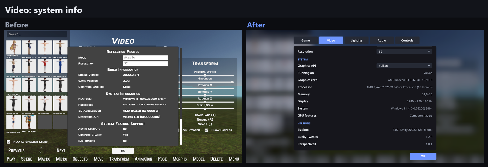
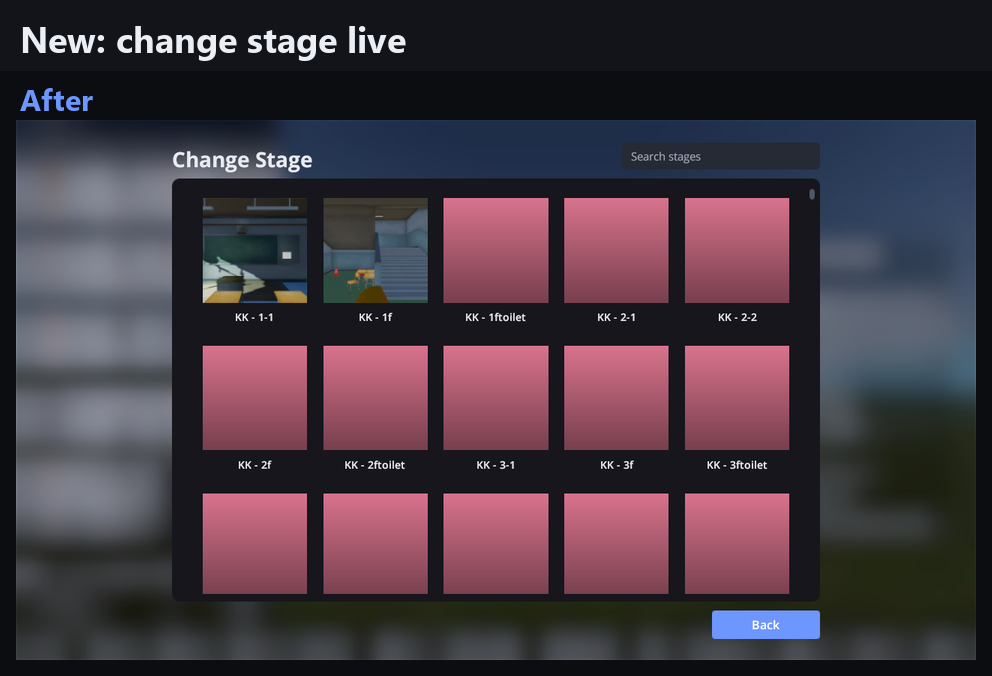
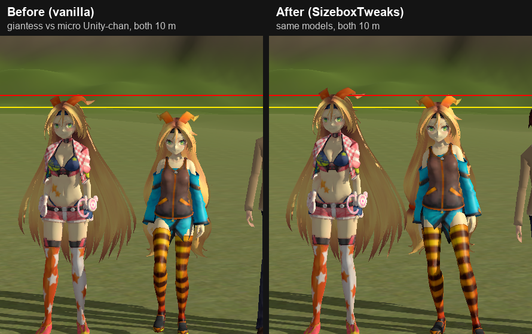

# Bucky Tweaks

A BepInEx plugin for Sizebox 3.02 that fixes stuff that bugged me, and plugs Koikatsu into it.

## Koikatsu maps in Sizebox

Got Koikatsu or Koikatsu Sunshine installed? **Every one of its maps is now a Sizebox stage.** No converting, no exporting, no Unity. Bucky Tweaks finds the game and loads the maps straight from its folder.

- **All the base maps.** The school, park, beach, hotel, aquarium and the rest, from both KK and KKS.
- **Your mod maps too.** Sideloader zipmods in `mods/` just show up. My install went from 7 stages to 540.
- **Actually playable.** Walk, climb stairs, stand on desks and benches, go giant without getting stuck on trees.
- **Nothing gets copied.** Uninstall KK and the stages simply disappear.

Installs that registered themselves are found automatically. Repacks often aren't: set `KoikatsuFolder` / `KoikatsuSunshineFolder` in F1 to the game folder (the one with `abdata` in it) and restart.

## Menus that don't look like 2009

Every menu got redone. One font, dark cards, everything lined up, way less clutter.

- **Pause menu** is short now and the game blurs behind it.
- **Settings** is one window with tabs: Game, Video, Lighting, Audio, Controls.
- **Change Stage** right from the pause menu. Search, pick, confirm, done.
- **Video** tells you what you're really running on (DX12, DX11 or Vulkan) and switches it for you with one restart.
- **Koikatsu stages** get a square picture of the map the first time you visit.






Don't like it? `UI > ModernMenus = false` in F1 brings the old menus back.

## Fixes

- **Less slidey movement.** Starting, stopping and turning are snappy now, no ice skating.
- **Real heights.** A character set to 180 cm is actually 180 cm tall. The game measured a box around the model, hair and hats included.
- **Normal jump.** About 50 cm instead of jumping over your own head.
- **Stairs.** Walks up steps and stair ramps.
- **Faster giantesses.** 2x by default, because big ones crawl.

Everything can be tweaked in game with F1.

Driver timeouts or crashes? Pick Vulkan in Settings > Video > Graphics API (or `Graphics > GraphicsApi` in F1). The game restarts itself once on Vulkan. A bit slower than DX12 on my card, but it didn't crash.



## Install

1. Get [BepInEx 5 x64](https://github.com/BepInEx/BepInEx/releases) and unzip it into the Sizebox folder (next to `Sizebox.exe`).
2. Unzip Bucky Tweaks into `BepInEx/plugins`.
3. Optional, for the F1 menu: [ConfigurationManager](https://github.com/BepInEx/BepInEx.ConfigurationManager/releases) (the BepInEx5 one), same folder.
4. Start the game twice. The first run sets BepInEx up.

Koikatsu: if it isn't picked up, set the game folder in F1 (see above) or in `BepInEx/config/sizebox.tweaks.cfg`.

To uninstall, delete `winhttp.dll` (turns off every mod) or the `BuckyTweaks` folder.

## Lua only

Don't want BepInEx? [`Lua_Lite/sizebox_tweaks_lite.lua`](Lua_Lite/sizebox_tweaks_lite.lua) does the jump and giantess speed. Lua can't reach the rest. Don't use both.

## Build

```
dotnet build -c Release
```

Needs the .NET SDK and the game installed next to this folder, or pass `-p:GameDir="path to Sizebox"`.

How it all works: [NOTES.md](NOTES.md).

First person camera: [Sizebox-PerspectiveX](https://github.com/bani4kaskashka/Sizebox-PerspectiveX).
